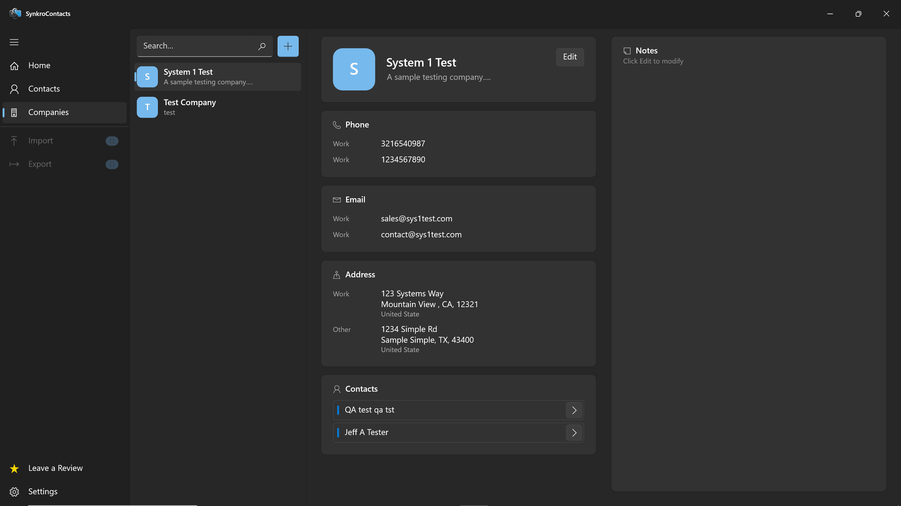
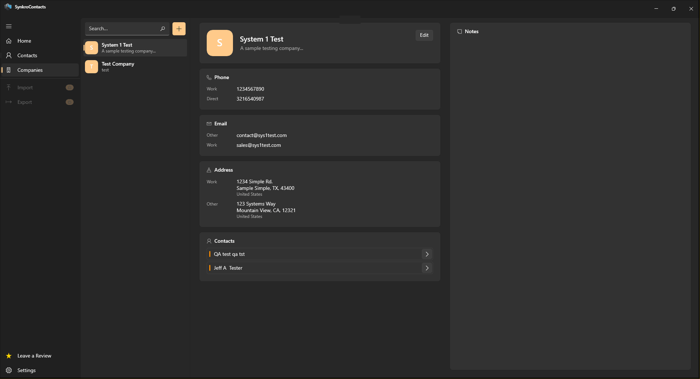
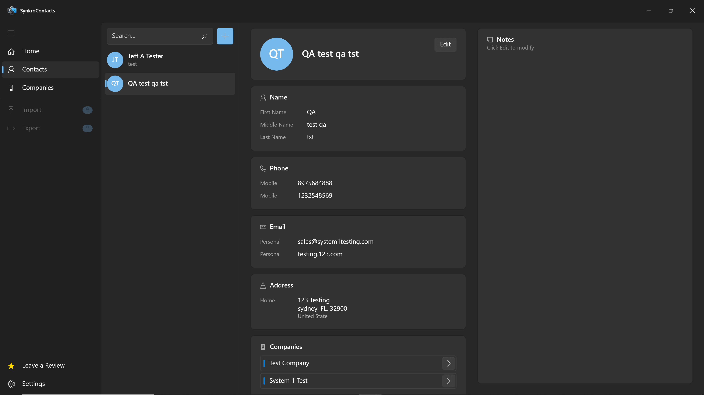
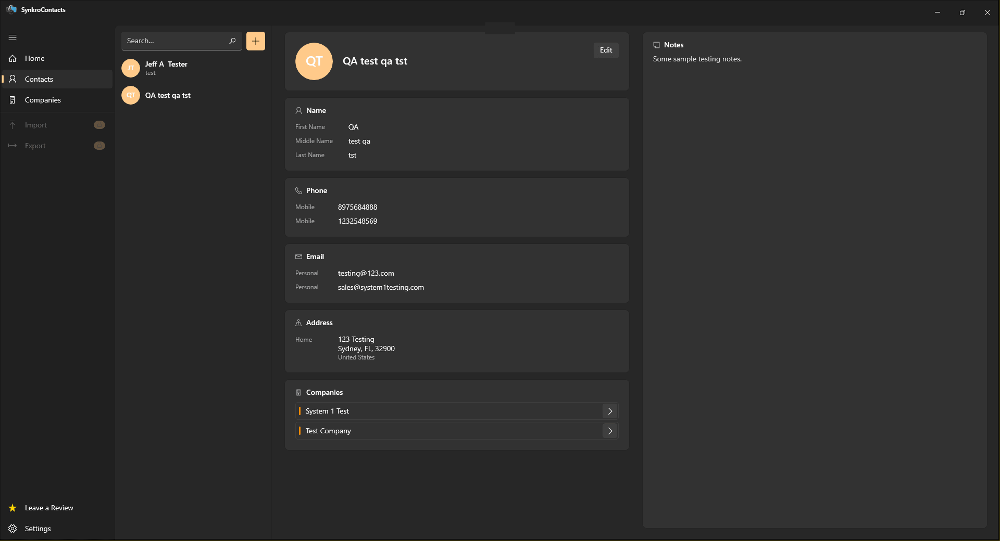

<div align="center">

  

  <h1>SynkroContacts</h1>
  <p><b>A modern, fast, and offline-first Windows desktop app for managing contacts and companies.</b></p>

  <p>
    <a href="../../releases/latest"></a>
    
    
    
    
  </p>

  <p>
    <a href="#-screenshots">Screenshots</a> •
    <a href="#-features">Features</a> •
    <a href="#-project-structure">Project Structure</a> •
    <a href="#-download--installation">Download & Run</a>
  </p>

</div>

---

## 📸 Screenshots

| Blue Theme | Gold Theme |
| :---: | :---: |
|  |  |
|  |  |

---

## ✨ Features

<table>
  <tr>
    <td width="50%" valign="top">
      <b>👥 Contacts & Companies Linking</b><br />
      Link multiple contacts to companies and easily jump between a company and its people with a single click.
    </td>
    <td width="50%" valign="top">
      <b>📞 Detailed Profiles</b><br />
      Store multiple phone numbers, emails, and addresses for each contact or company, and mark your preferred ones.
    </td>
  </tr>
  <tr>
    <td width="50%" valign="top">
      <b>🔄 vCard (.vcf) Import & Export</b><br />
      Easily back up or move your contacts using standard <code>.vcf</code> files powered by <code>FolkerKinzel.VCards</code>.
    </td>
    <td width="50%" valign="top">
      <b>🔒 100% Local & Private</b><br />
      No cloud or internet required. All data is saved locally in a SQLite database at <code>%AppData%\SynkroContacts\contacts.db</code>.
    </td>
  </tr>
</table>

---

## 🏗 Project Structure

The solution is built with **.NET 8** (`net8.0-windows10.0.19041.0`) and follows a clean **MVVM** architecture across 5 projects:

```text
SynkroContacts.sln
├── SynkroContacts/             # UI Layer (8 Views, ViewModels, Themes & App Startup)
├── SynkroContacts.Services/    # Business Logic (Contacts, Companies, vCard, Logging, Notifications)
├── SynkroContacts.Data/        # Database Layer (EF Core 8 DbContext, Entities & SQLite Migrations)
├── SynkroContacts.DataMapping/ # Data Mappers (Entity <-> Model conversion)
└── SynkroContacts.Models/      # Core Models, Computed Properties & Enums
```

### Tech Stack
| Package | Version | Usage |
| :--- | :---: | :--- |
| `Microsoft.EntityFrameworkCore.Sqlite` | `8.0.11` | Local SQLite database & migrations |
| `CommunityToolkit.Mvvm` | `8.3.2` | MVVM data binding & commands |
| `FolkerKinzel.VCards` | `7.2.1` | Reading and writing `.vcf` vCard files |

---

## 🚀 Download & Installation

### Option 1: Download Pre-built Release (Recommended for Users)
1. Go to the [**Releases**](../../releases/latest) page.
2. Download the latest `SynkroContacts-win-x64.zip` archive.
3. Extract the ZIP file and run **`SynkroContacts.exe`**.

### Option 2: Build from Source (For Developers)
**Requirements:** Windows 10 (1809+) or Windows 11 (`x64`), [.NET 8 SDK](https://dotnet.microsoft.com/download/dotnet/8.0), and [Visual Studio 2022](https://visualstudio.microsoft.com/) (`.NET desktop development` workload).

1. Clone the repository:
   ```bash
   git clone https://github.com/jackstatham596/SynkroContacts.git
   cd SynkroContacts
   ```
2. Open **`SynkroContacts.sln`** in **Visual Studio 2022**.
3. Set the build platform to **`x64`** and press <kbd>F5</kbd> to build and run.

---

## 📄 License

This project is licensed under the [MIT License](LICENSE).

<div align="center">
  <p><sub>Built with ❤️ using C# & .NET 8</sub></p>
</div>

<div align="center">
  
  <p><sub>Released under the MIT License • Engineered with C# & .NET 8</sub></p>
</div>
